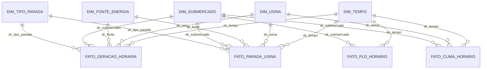

# Documento de Modelagem Dimensional — Data Warehouse Campo Real Energia

**Aluno:** Eduardo Iensen Prestes  
**Banco de Dados:** PostgreSQL (`schema` de origem: `campo_real_energia` | `schema` dimensional: `dw_campo_real`)

---

## 1. Visão Geral da Arquitetura

O Data Warehouse da **Campo Real Energia** foi projetado seguindo a metodologia dimensional de Ralph Kimball (*Star Schema*), separando fisicamente:
1. **Camada Operacional e Bruta (`campo_real_energia`):** preserva intactas as tabelas transacionais do legado (`submercado`, `fonte_energia`, `usina`, `feriado_nacional`, `parada_usina`, `medicao_geracao`, `log_carga`) e armazena os payloads brutos extraídos das APIs externas (`raw_pld_horario` e `raw_clima_horario`), além das tabelas de auditoria da Etapa 2 (`profiling_tabelas`, `metricas_qualidade` e `quarentena_registros`).
2. **Camada Dimensional (`dw_campo_real`):** estrutura em estrela composta por **5 tabelas de dimensão** e **4 tabelas fato**, além de **6 views analíticas** voltadas ao consumo direto pelas ferramentas de BI (Tableau / Power BI).

---

## 2. Matriz de Barramento (Bus Matrix)

A matriz de barramento abaixo relaciona os quatro processos de negócio modelados às dimensões conformadas do Data Warehouse:

| Processo de Negócio | Tabela Fato | `dim_tempo` | `dim_usina` | `dim_fonte_energia` | `dim_submercado` | `dim_tipo_parada` |
| :--- | :--- | :---: | :---: | :---: | :---: | :---: |
| **1. Medição e Valoração da Geração** | `fato_geracao_horaria` | X | X | X | X | X |
| **2. Formação de Preço Spot (PLD)** | `fato_pld_horario` | X | — | — | X | — |
| **3. Indisponibilidade e Paradas** | `fato_parada_usina` | X | X | X | X | X |
| **4. Condições Meteorológicas Locais** | `fato_clima_horario` | X | X | — | X | — |

---

## 3. Declaração Formal de Grão das Tabelas Fato

Cada tabela fato possui seu grão atômico declarado explicitamente:

1. **`dw_campo_real.fato_geracao_horaria`**
   - **Grão declarado:** 1 registro por usina operacional válida por hora do calendário (`sk_tempo`, `sk_usina`).
   - **Cardinalidade em 2025:** $9\text{ usinas} \times 8.760\text{ horas} = 78.840\text{ registros}$.
   - **Medidas principais:** `energia_gerada_mwh` (limpa), `energia_bruta_origem_mwh` (antes da limpeza), `disponibilidade_mw`, `potencia_instalada_mw`, `pld_hora_r_mwh`, `receita_pld_brl` (limpa), `receita_bruta_origem_brl` (antes da limpeza) e `atraso_recebimento_horas`.

2. **`dw_campo_real.fato_pld_horario`**
   - **Grão declarado:** 1 registro por submercado do SIN por hora do calendário (`sk_tempo`, `sk_submercado`).
   - **Cardinalidade:** $4\text{ submercados} \times 8.760\text{ horas} = 35.040\text{ registros}$ em 2025, mais $29.760\text{ registros}$ publicados de 2026 (total = $64.800\text{ registros}$).
   - **Medida principal:** `pld_r_mwh` (Preço de Liquidação das Diferenças em R\$/MWh).

3. **`dw_campo_real.fato_parada_usina`**
   - **Grão declarado:** 1 registro por usina por hora em condição de parada operacional válida (`sk_tempo`, `sk_usina`, `id_parada_natural`).
   - **Cardinalidade em 2025:** $1.672\text{ horas-usina}$ distribuídas nos 10 eventos válidos de manutenção programada ou falha forçada.
   - **Medidas principais:** `horas_indisponiveis` (1,0 h por linha), `potencia_indisponivel_mw`, `fator_capacidade_esperado`, `energia_nao_gerada_estimada_mwh`, `pld_hora_r_mwh` e `perda_receita_estimada_brl`.

4. **`dw_campo_real.fato_clima_horario`**
   - **Grão declarado:** 1 registro por usina (coordenada geográfica da planta) por hora do calendário (`sk_tempo`, `sk_usina`).
   - **Cardinalidade em 2025:** $9\text{ usinas} \times 8.760\text{ horas} = 78.840\text{ registros}$.
   - **Medidas principais:** `radiacao_solar_wm2`, `velocidade_vento_10m_kmh`, `velocidade_vento_100m_kmh`, `temperatura_2m_c` e `precipitacao_mm`.

---

## 4. Diagrama do Star Schema (`dw_campo_real`)

---

## 5. Decisões de Projeto Dimensional

### 5.1 Chaves Substitutas (`sk_*`) e Membro Desconhecido (`-1`)
Todas as 5 dimensões utilizam chaves substitutas inteiras (`sk_tempo`, `sk_submercado`, `sk_fonte`, `sk_usina`, `sk_tipo_parada`). Em `dim_tempo`, a chave substituta possui formato inteligente `YYYYMMDDHH` (ex.: `2025010100`), facilitando o particionamento e leitura humana.  
Todas as dimensões possuem o registro explícito `sk = -1` (**Membro Desconhecido / Não Aplicável**). Na tabela `fato_geracao_horaria`, horas de operação normal apontam para `sk_tipo_parada = -1` (`'Sem Parada'`), evitando chaves estrangeiras nulas na tabela fato.

### 5.2 Por que manter `dim_usina`, `dim_fonte_energia` e `dim_submercado` como dimensões conformadas?
Embora uma usina pertença a uma fonte e a um submercado, mantivemos `dim_submercado` e `dim_fonte_energia` como dimensões conformadas independentes (além de desnormalizar seus atributos descritivos em `dim_usina`) porque:
- `fato_pld_horario` existe no grão **submercado $\times$ hora** (não possui usina), exigindo `dim_submercado` como dimensão conformada para cruzar PLD e geração no BI sem *join* muitos-para-muitos.
- Incluir `sk_fonte` e `sk_submercado` diretamente em `fato_geracao_horaria` e `fato_parada_usina` permite agregações diretas por fonte e submercado em estrela pura (*Star Schema*), sem exigir *Snowflake* obrigatório.

### 5.3 Estratégia de SCD (Slowly Changing Dimension) em `dim_usina`
Adotamos uma política híbrida **SCD Tipo 2 + SCD Tipo 1** na tabela `dim_usina`:
- **SCD Tipo 2 (versionamento histórico com `data_inicio_vigencia`, `data_fim_vigencia`, `flag_registro_atual` e `versao_registro`):** aplicado aos atributos operacionais que podem mudar legitimamente ao longo da vida útil da planta, como **`potencia_instalada_mw`** (ampliação ou repotenciação de unidades geradoras) e **`situacao`** (`'Em operação'`, `'Suspensa'`, `'Descomissionada'`). Se uma usina ampliar sua potência em 2026, o cálculo do fator de capacidade de 2025 precisa preservar a potência vigente em 2025.
- **SCD Tipo 1 (sobrescrita sem criar nova versão):** aplicado às correções de erros cadastrais de digitação identificados na Etapa 2 (`latitude` invertida de `+15.803` para `-15.803` em `CRE-UFV-004`, `uf` incorreta `'PE'` corrigida para `'SP'` em `CRE-BIO-005` e `data_inicio_operacao` `'2031-02-01'` corrigida para `'2019-02-01'` em `CRE-UFV-006`), pois tais valores nunca representaram estados reais da usina no mundo físico.

### 5.4 Tratamento de Diferentes Granularidades e Vínculo Geográfico
- **Feriados nacionais (`data` diária) $\to$ `dim_tempo` (horária):** cada data da tabela `feriado_nacional` é propagada para as 24 horas correspondentes em `dim_tempo`, determinando o atributo `flag_dia_util` e o `patamar_carga` (`Leve`, `Média`, `Pesada`).
- **Intervalos de paradas (`inicio` a `fim`) $\to$ grão horário:** na `fato_parada_usina`, os intervalos de parada são expandidos com `generate_series(inicio, fim, '1 hour')` para o mesmo grão horário do PLD e da geração, permitindo valorar cada hora parada exatamente pelo PLD daquela hora no respectivo submercado.
- **Clima Open-Meteo (coordenadas `latitude, longitude`) $\to$ `dim_usina` e `dim_submercado`:** a consulta na API Historical Weather da Open-Meteo utiliza as coordenadas geográficas corrigidas de cada uma das 9 usinas, vinculando 1:1 a série meteorológica horária à chave substituta `sk_usina` e `sk_submercado`.

